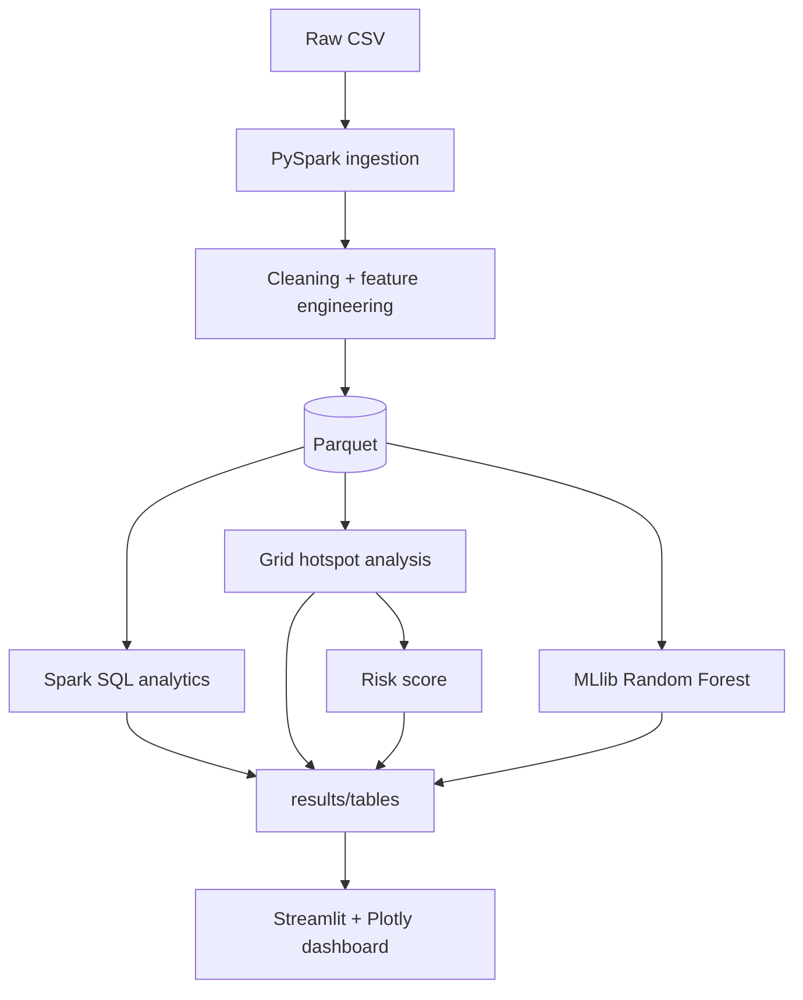

# System Architecture

```
            Raw Dataset (US Accidents CSV, data/raw/)
                          │
                          ▼
              PySpark Data Ingestion (preprocessing.py)
                          │
                          ▼
     Data Cleaning  ── types, nulls, duplicates, invalid rows
                          │
                          ▼
     Feature Engineering ── hour, day, month, weather group, night, grid cell
                          │
                          ▼
         Parquet (data/processed/accidents_clean.parquet)
                          │
                          ▼
              Spark SQL Analytics (analysis.py)
                          │
        ┌─────────────────┼───────────────────┐
        ▼                 ▼                   ▼
  Trend Analysis   Hotspot Analysis      Risk Analysis
  (analysis.py)  (hotspot_analysis.py)  (risk_score.py)
                          │
                          ▼
              Spark MLlib Random Forest (model.py)
                          │
                          ▼
                Severity Prediction + Metrics
                          │
                          ▼
     Small aggregated outputs  (results/tables/*.csv, *.json, *.parquet)
                          │
                          ▼
          Streamlit + Plotly Dashboard (dashboard/app.py)
          (uses Pandas only - never starts Spark)
```



## Design decisions
* **Spark does the heavy work once**; the dashboard reads kilobytes-to-megabytes of results,
  so it starts instantly and does not need Java/Spark.
* **Parquet** (columnar, compressed, partitioned by `Year`) is the hand-off format between stages.
* **Dashboard "cubes"** (`cube_time`, `cube_hour`): Spark pre-aggregates counts by
  State × Severity × Weather × Year × (Month | Day × Hour) so sidebar filters work without raw data.
* **Central config** (`src/config.py`) holds paths, thresholds, weights and seeds.
* **Sample mode** (`--sample` / `CA3_SAMPLE=1`) writes to separate folders so synthetic output can
  never be mixed with real results.

## Module responsibilities
| File | Responsibility |
|---|---|
| `config.py` | paths, constants, weights, seeds |
| `spark_session.py` | creates the local SparkSession |
| `preprocessing.py` | load, validate, clean, engineer, write Parquet |
| `analysis.py` | Spark SQL queries + dashboard cubes |
| `hotspot_analysis.py` | ~1 km grid counting and hotspot flag |
| `risk_score.py` | weighted risk score + Low/Moderate/High/Critical |
| `model.py` | MLlib pipeline, evaluation, confusion matrix, importances |
| `run_pipeline.py` | runs everything in order, handles errors |
| `make_sample.py` | generates the synthetic smoke-test file |
